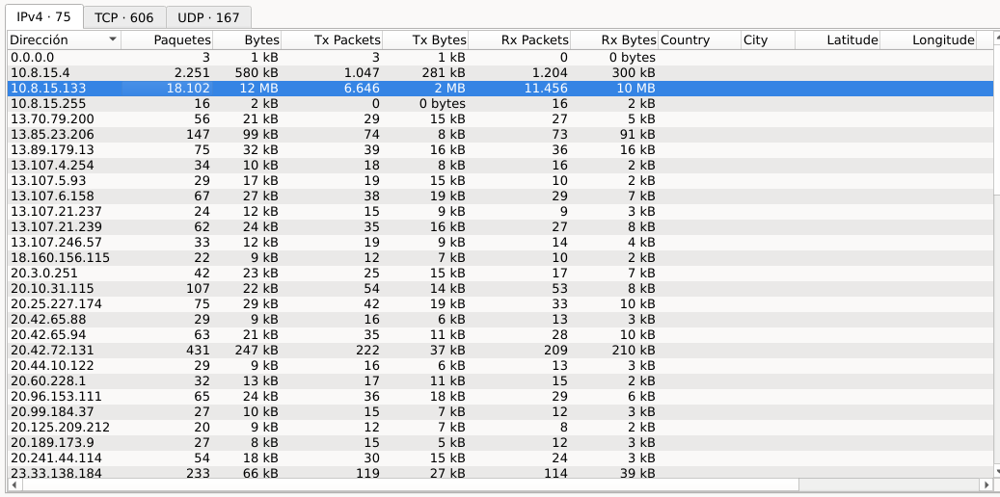
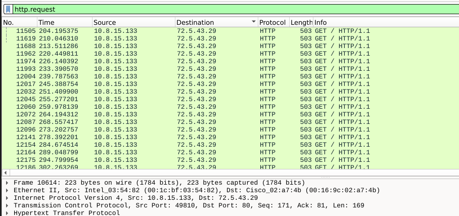
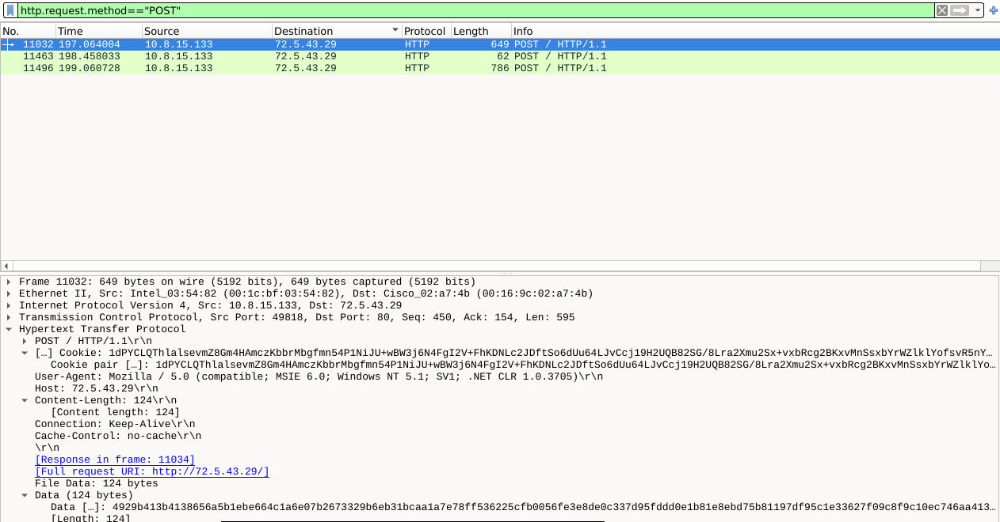
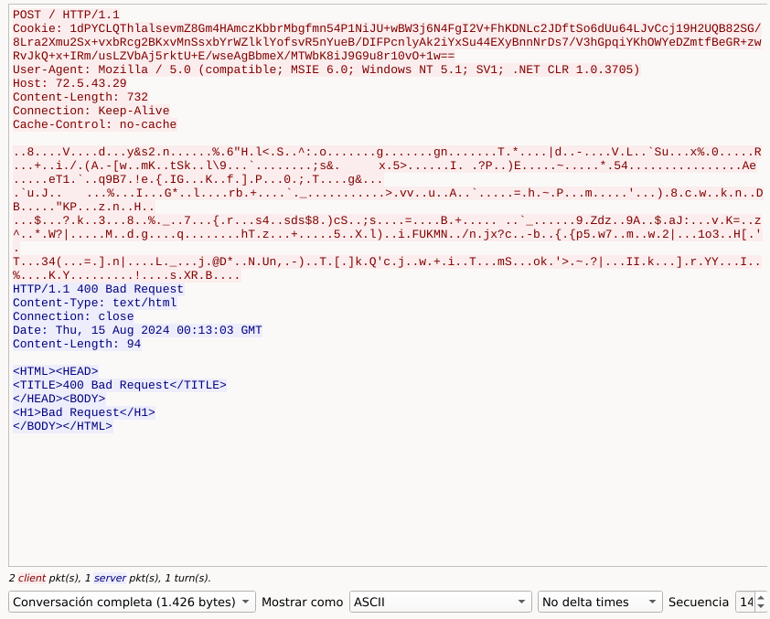

# 🔍 Malware Traffic Analysis: C2 Infrastructure & Data Exfiltration

> 🌐 **Language / Idioma:** 🇬🇧 English | 🇪🇸 [Leer reporte en Español](./README.md)

---

## 📌 Executive Summary
A network forensic analysis was conducted on the packet capture `2024-08-15-traffic-analysis-exercise.pcap` following a suspected internal malware infection. The investigation successfully identified the victim host, external Command and Control (C2) infrastructure, automated beaconing patterns, and active data exfiltration over unencrypted HTTP protocol.

---

## 🎯 Scope & Key Indicators (IoCs)

### Affected Host
* **Victim IP:** `10.8.15.133`
* **Hostname:** `DESKTOP-70AL28V`
* **MAC Address:** `00:0c:29:ed:13:90`

### Key Indicators of Compromise (IoCs)
| Type | Indicator / Value | Description |
| :--- | :--- | :--- |
| **Domain** | `lafontainebleu.org` | Primary malicious domain tied to C2 infrastructure. |
| **Subdomain** | `win-jegjix7q9rs.lafontainebleu.org` | Dynamically generated DNS query. |
| **IPv4** | `72.5.43.29` | External C2 Server IP (HTTP Service / Port 80). |
| **User-Agent** | `Mozilla/4.0 (compatible; MSIE 6.0; ...)` | Spoofing legacy IE6 / Windows XP User-Agent for evasion. |

---

## 🔬 Investigation Methodology & Evidence

### 1. Victim Identification (DHCP)
Using the `bootp` (DHCP) filter, the network assignment transaction was analyzed to bind IP `10.8.15.133` with the MAC address and hostname of the compromised system.

---

### 2. Hostile Infrastructure Resolution (DNS)
Applying the `dns` filter, multiple queries were identified requesting `lafontainebleu.org` and dynamic subdomains. The `Standard query response` verified resolution to the external IP `72.5.43.29`.

---

### 3. Beaconing & Exfiltration Pattern (HTTP)
* **HTTP GET (Beaconing):** Filtering by `http.request`, a repetitive sequence of `GET` requests to `72.5.43.29` was discovered, indicating active C2 beaconing.
* **HTTP POST (Exfiltration):** Using `http.request.method == "POST"`, request headers were inspected, revealing long obfuscated `Cookie` headers and raw payload data (`Data: 124 bytes`) being transmitted outbound.

---

### 4. Full Session Inspection (TCP Stream)
Following the TCP stream of the `POST` connection confirmed that the C2 server returned an `HTTP/1.1 400 Bad Request` status code. Despite the server-side error, outbound telemetry exfiltration intent was definitively verified.

---

##  Technical Summary & Attack Chain
The victim host (`DESKTOP-70AL28V`) sustained a security compromise involving an automated malware agent with C2 communication capabilities. The malicious process initialized by resolving dynamic domains via DNS (`lafontainebleu.org`), followed by an active beaconing loop via periodic HTTP `GET` requests to external IP `72.5.43.29`.

Subsequently, the malware attempted outbound exfiltration of internal host telemetry by embedding obfuscated data into HTTP `POST` headers (suspicious cookie strings). The traffic masqueraded behind a legacy User-Agent (Internet Explorer 6 on Windows XP) to evade basic perimeter filters. Although the C2 server responded with `400 Bad Request` (indicating potential server-side instability or payload mismatch), active exfiltration traffic was fully captured and verified.

---

##  SOC Analyst Conclusion
This incident highlights the importance of deep packet inspection across application-layer protocols (DNS and HTTP) when perimeter controls are bypassed or when malware employs evasion techniques. Combining raw network analysis, TCP stream tracking, and solid IoC correlation enables Tier 1 SOC Analysts to accurately scope threats, contain host compromise, and support endpoint incident response teams.

---

