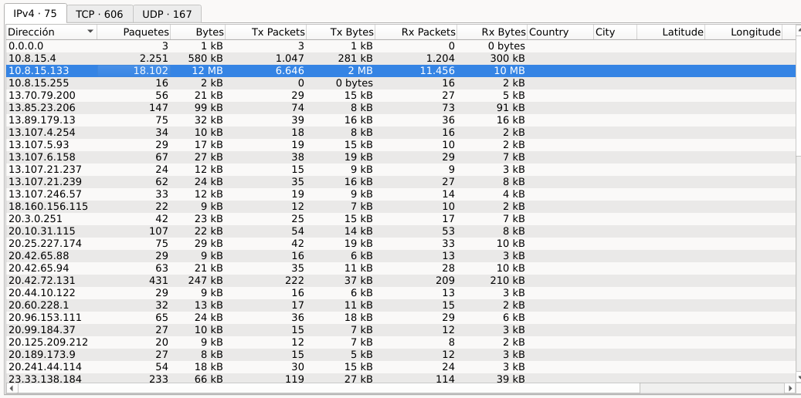
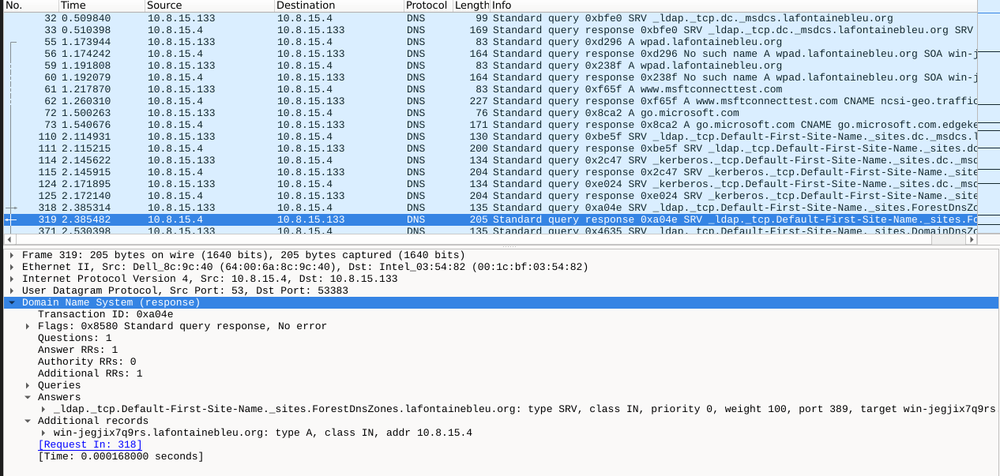
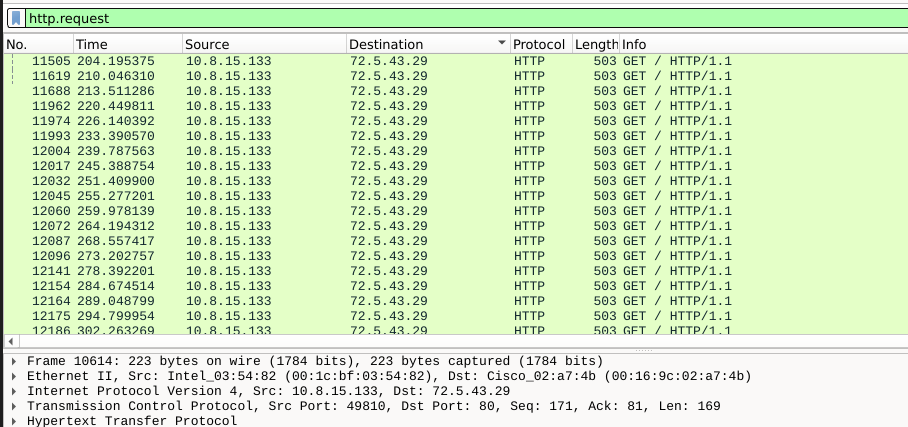
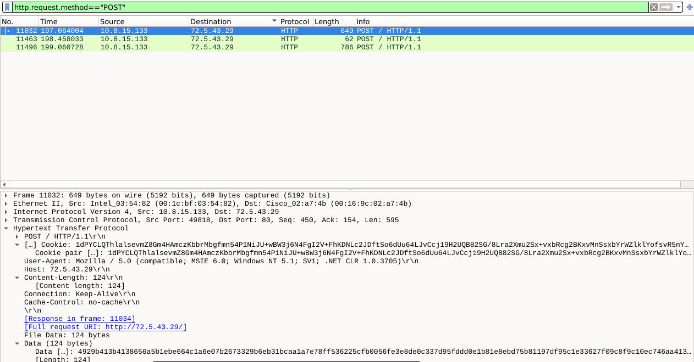
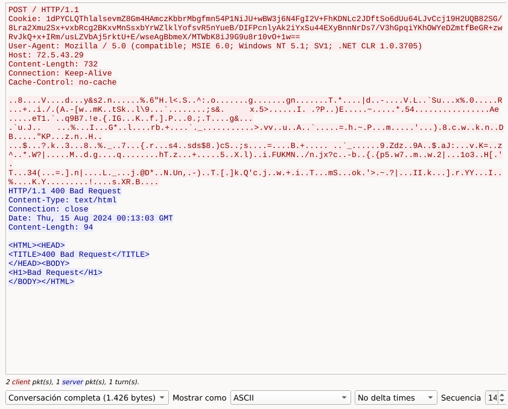

# add PCAP C2 analysis and exfiltration report
# Malware Traffic Analysis: C2 Infrastructure & Data Exfiltration

##  Executive Summary
Análisis forense de red realizado sobre la captura `2024-08-15-traffic-analysis-exercise.pcap` para identificar indicios de compromiso. Se logró determinar el host víctima, la infraestructura externa de Comando y Control (C2), el patrón de balizamiento (*beaconing*) por HTTP y la exfiltración activa de datos del sistema.

---

##  Scope & Key Indicators (IoCs)

### Host Impactado
* **IP Víctima:** `10.8.15.133`
* **Hostname:** `DESKTOP-70AL28V`
* **MAC Address:** `00:0c:29:ed:13:90`

### Indicadores de Compromiso (IoCs)
| Tipo | Indicador / Valor | Descripción |
| :--- | :--- | :--- |
| **Domain** | `lafontainebleu.org` | Dominio asociado a la infraestructura maliciosa. |
| **Subdomain** | `win-jegjix7q9rs.lafontainebleu.org` | Consulta DNS dinámica generada por el malware. |
| **IPv4** | `72.5.43.29` | Dirección IP del Servidor C2 (Puerto 80 / HTTP). |
| **User-Agent** | `Mozilla/4.0 (compatible; MSIE 6.0; ...)` | Suplantación de identidad de navegador heredado. |

---

##  Investigation Methodology & Evidence

### 1. Identificación de la Víctima (DHCP)
Se revisaron las tramas de red para asociar la IP `10.8.15.133` al equipo y su dirección física.

---

### 2. Detección de Infraestructura Hostil (DNS)
A través de las consultas DNS, se identificó la resolución de subdominios hacia la IP externa `72.5.43.29`.

---

### 3. Patrón de Beaconing y Exfiltración (HTTP)
* **GET Requests:** Tráfico recurrente simulando balizas de conexión hacia el C2.
* **POST Requests:** Envío de paquetes con cabeceras sospechosas y cookies ofuscadas.

---

### 4. Inspección de Sesión (TCP Stream)
El seguimiento del flujo TCP confirmó la interacción con el servidor C2 y la respuesta de control recibida (`400 Bad Request`).

---
---

##  Resumen Técnico y Cadena de Eventos (Attack Chain)
El host de la víctima (`DESKTOP-70AL28V`) experimentó un compromiso de seguridad caracterizado por la ejecución de un agente de malware con capacidades de balizamiento automatizado. El proceso malicioso estableció comunicación inicial resolviendo dominios dinámicos a través de la infraestructura de DNS (`lafontainebleu.org`), para luego iniciar una rutina persistente de balizamiento (*C2 Beaconing*) mediante solicitudes HTTP `GET` periódicas hacia el servidor de Comando y Control externo (`72.5.43.29`). 

Posteriormente, el malware intentó exfiltrar datos internos del sistema empaquetándolos en peticiones HTTP `POST` con cabeceras ofuscadas (como cadenas de cookies sospechosas), camuflando su tráfico mediante la suplantación de un *User-Agent* obsoleto (Internet Explorer 6 en Windows XP) para intentar evadir filtros de inspección superficiales. La respuesta `400 Bad Request` obtenida del servidor sugiere un desajuste en el formato esperado o una inestabilidad temporal en el extremo del atacante, pero evidencia fehacientemente el intento activo de exfiltración de telemetría.

---

##  Conclusión del Analista 
Este incidente demuestra la alta efectividad de la visibilidad de red y el análisis de protocolos de capa de aplicación (DNS y HTTP) para detectar anomalías cuando los controles perimetrales tradicionales fallan o el malware intenta evadir inspecciones. La combinación de análisis de tráfico crudo, rastreo de flujos TCP y la identificación de IoCs sólidos (como dominios y patrones de tráfico) permite a un analista SOC Tier 1 documentar y contener la amenaza con precisión milimétrica, facilitando la transición hacia los equipos de respuesta a incidentes en el endpoint.
